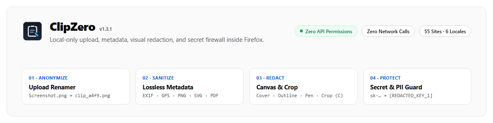
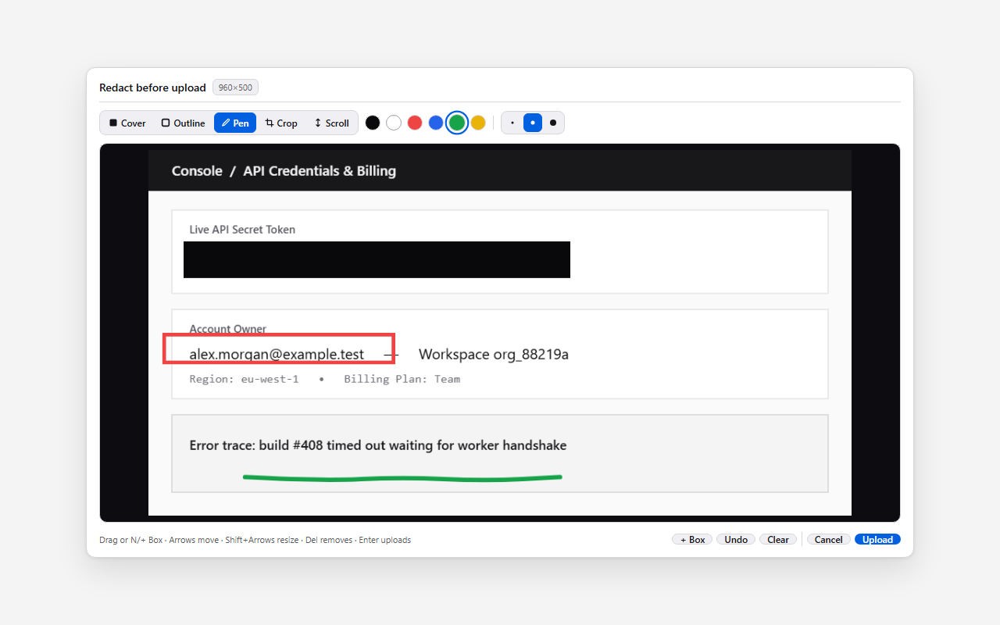
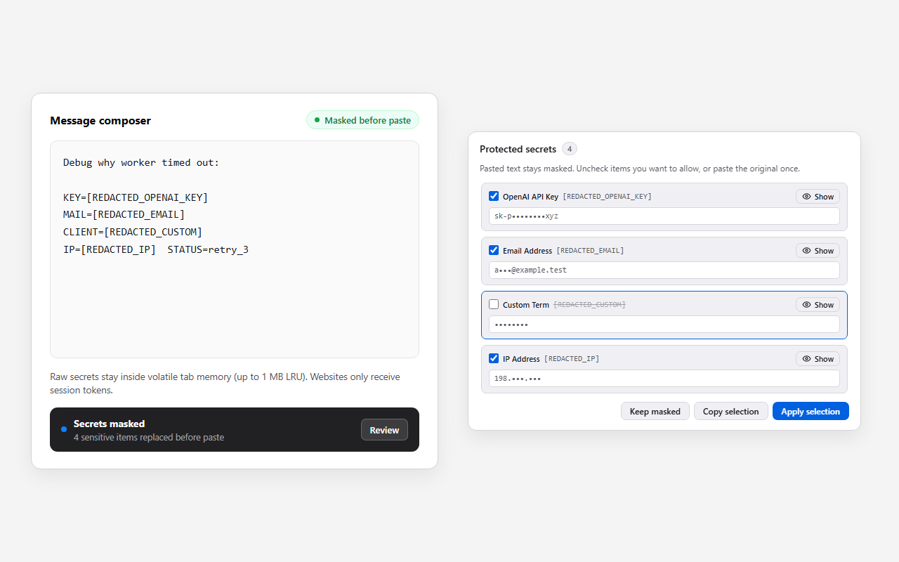
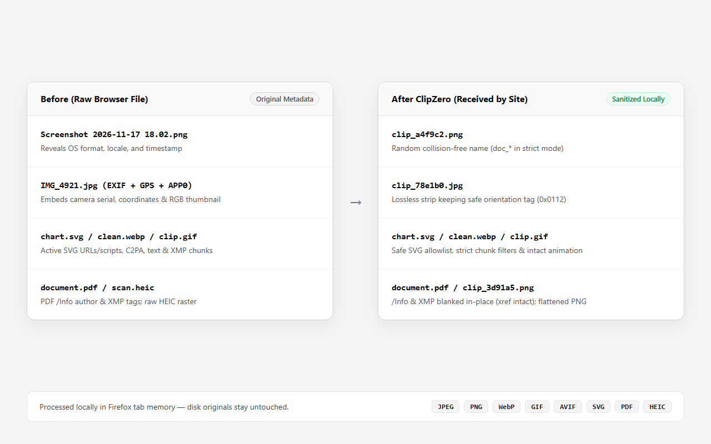

<div align="center">



<br><br>

[](https://addons.mozilla.org/firefox/addon/clipzero/)
[](https://github.com/m21dev/clipzero/actions/workflows/ci.yml)


[Install on Firefox Add-ons](https://addons.mozilla.org/firefox/addon/clipzero/) · [Releases](https://github.com/m21dev/clipzero/releases) · [Roadmap](ROADMAP.md) · [Changelog](CHANGELOG.md) · [Security](SECURITY.md)

</div>

<br>

ClipZero intercepts file uploads and clipboard pastes **inside your Firefox tab** before websites read them—with **zero API permissions**, **zero network calls**, and **unminified source code**.

- **Anonymize filenames:** Renames pasted, dropped, and picked files (`clip_XXXXXX.png` / `doc_XXXXXX.*`) and flattens `.bmp`, `.ico`, `.tiff`, and `.heic` rasters to `.png`.
- **Clean metadata losslessly:** Strips JPEG EXIF/GPS/APP0, PNG and WebP chunks (`iDOT`, `C2PA`, text), GIF comments/XMP, static AVIF markers, active SVG vectors, and PDF `/Info` + XMP fields in-place.
- **Redact & crop before upload (`v1.3.1`):** Permanent **Cover** fills, **Outline** boxes, and **Pen** strokes (`Thin` / `Medium` / `Thick`), non-destructive **Crop (`C`)**, mobile **Scroll (`H`)**, and single-touch `pointerId` lock.
- **Mask secrets & PII on paste:** Replaces API keys, tokens, JWTs, Luhn cards, IBANs, URL credentials, optional contacts/IPs, and **Custom hidden words** with consistent session tokens (`[REDACTED_*_N]`).

---

## Screenshots

<p align="center">
  <br>
  <sub><b>Pre-upload Canvas Redactor</b> — Cover, Outline, Pen stroke widths, Crop (<code>C</code>), Scroll (<code>H</code>), and chronological Undo.</sub>
</p>

<br>

<p align="center">
  <br>
  <sub><b>Zero-Permission Tabbed Popup</b> — Per-tab toggles, Custom hidden words, shortcuts, and automatic reload detection (<code>!</code>) across 55 hosts.</sub>
</p>

<br>

<p align="center">
  <br>
  <sub><b>Secret, PII &amp; Custom Words Guard</b> — Masks keys and contacts before paste with per-item Review checkboxes and Restore originals.</sub>
</p>

<br>

<p align="center">
  <br>
  <sub><b>Filename Anonymizer &amp; Lossless Scrubber</b> — Cleans identifying metadata in tab memory without touching originals on disk.</sub>
</p>

---

## Install

- **Firefox Desktop (`140+`) & Android (`142+`):** Install the signed release from **[addons.mozilla.org/firefox/addon/clipzero](https://addons.mozilla.org/firefox/addon/clipzero/)**.
- **Unpacked source (development):** Open `about:debugging#/runtime/this-firefox` → **Load Temporary Add-on…** → select [`manifest.json`](manifest.json).

---

## Reference

<details>
<summary>What's new in v1.3.1</summary>

- **Active `pointerId` multi-touch lock:** Ignores secondary finger or palm contacts mid-stroke, with `lostpointercapture` cleanup.
- **Stroke weight selector:** Added **Thin**, **Medium**, and **Thick** sizes for **Outline** and **Pen**, scaled accurately at export resolution.
- **Non-destructive Crop (`C`):** Interactive margin cropping with live dimensions, aligned box mapping, and arrow-key clamping inside active crops.
- **Scroll mode (`H`) & tall-portrait layout:** Touch `pan-x pan-y` plus desktop mouse drag-to-pan alongside scrollable tall-portrait canvas sizing.
- **Chronological Undo & hardening:** `Delete` / `Backspace` on boxes is now undoable via `Undo` (`Ctrl/Cmd+Z`), expanded `document_start` native captures, widened SVG `marker` URL & PDF XMP sanitization, hardened `MessagePort` handshakes, and `clipzero:disarm-reload` cleanup (`152` locale keys × 6).

</details>

<details>
<summary>Supported file formats &amp; limits</summary>

| Format | Sanitization | Notes |
| :--- | :--- | :--- |
| **JPEG** | Strips EXIF, GPS, XMP &amp; APP0 RGB thumbnails | Preserves safe orientation tag (`0x0112`) across progressive scans |
| **PNG / WebP** | Rebuilt via strict chunk allowlists | Removes `iDOT`, `C2PA`, `eXIf`, `tEXt`, `zTXt`, `iTXt` |
| **GIF / AVIF** | Strips GIF Comment/XMP; re-exports static AVIFs with metadata | Keeps animated `NETSCAPE2.0` GIF frames intact |
| **SVG** | Removes `<script>`, `<foreignObject>`, `on*`, unsafe URIs, CSS URLs &amp; `marker` URLs | Up to `8 MB` |
| **PDF** | Blanks `/Info` (direct, `#xx`, indirect) &amp; XMP packets in-place | Up to `50 MB`; `xref` tables &amp; bookmarks preserved |
| **Exotic Rasters** | Flattens `.bmp`, `.ico`, `.tiff`, `.heic`/`.heif` cleanly to `.png` | Handled via local Canvas when browser-decodable |

</details>

<details>
<summary>Supported websites (55 host patterns)</summary>

- **AI Chats & Builders:** Gemini, AI Studio, ChatGPT, Claude, Perplexity, Grok, Mistral (`chat.mistral.ai`, `lechat.mistral.ai`), Copilot, Poe, HuggingChat (`/chat/*`), DeepSeek, Qwen, Kimi, Z.ai, ChatGLM, Doubao, Yuanbao, Ernie/Yiyan, NotebookLM, v0, Bolt, Lovable, OpenRouter, Duck.ai.
- **Developer:** GitHub.
- **Messaging & Social:** WhatsApp Web, Telegram Web, Discord, Messenger, Facebook (`www`, `m`), Instagram, X / Twitter, Reddit, LinkedIn.
- **Webmail:** Gmail, Outlook (`live.com`, `office.com`, `office365.com`, `cloud.microsoft`).

</details>

<details>
<summary>Keyboard shortcuts (Global &amp; Canvas Modal)</summary>

| Windows / Linux | macOS | Action |
| :--- | :--- | :--- |
| `Alt+Shift+P` | `MacCtrl+Shift+P` | Pause / resume protection on active tab |
| `Alt+Shift+S` | `MacCtrl+Shift+S` | Rename all files &amp; documents |
| `Alt+Shift+E` | `MacCtrl+Shift+E` | Toggle lossless metadata cleaning |
| `Alt+Shift+B` | `MacCtrl+Shift+B` | Toggle pre-upload Canvas editor |
| `Alt+Shift+K` | `MacCtrl+Shift+K` | Toggle Secret &amp; API Key Guard |
| `Alt+Shift+T` | `MacCtrl+Shift+T` | Show / hide on-screen notice |
| `Alt+Shift+G` | `MacCtrl+Shift+G` | Remember / forget settings for current site |

Inside the Canvas modal: `N` (add box), `O` (Outline), `P` (Pen), `C` (Crop), `H` (Scroll), `[` / `]` (cycle boxes), `Arrows` / `Shift+Arrows` (move / resize), `Del` (remove, undoable), `Ctrl`/`Cmd+Z` (Undo), `PageUp`/`PageDown` (slides), `Enter` (Upload).

</details>

<details>
<summary>Architecture &amp; repository checks</summary>

1. **`content.js` (`MAIN` @ `document_start`):** Captures native DOM/Canvas/MessagePort/Event globals early, sanitizes locally, isolates UI in closed Shadow DOM, and cleans up `ImageBitmap` / `<canvas>` buffers immediately.
2. **`bridge.js` (`ISOLATED` @ `document_start`):** Relays localized strings (`6` locales × `152` keys), commands, and state queries over a confirmed `MessageChannel`.
3. **`site_match.js` &amp; `background.js`:** Detects open tabs missing injection (`!`) after install/update, manages permission-reload arming/disarming, and forwards shortcuts with `0` API permissions.

```bash
python tests/verify_repo.py   # Manifest, locales (152 keys x6), static sinks & JS syntax
python scripts/package.py     # Builds clean runtime ZIP inside dist/
```

</details>

---

[GNU General Public License v3.0 or later](LICENSE) · [Security Policy](SECURITY.md) · [Support `@m21dev` on GitHub Sponsors](https://github.com/sponsors/m21dev)
