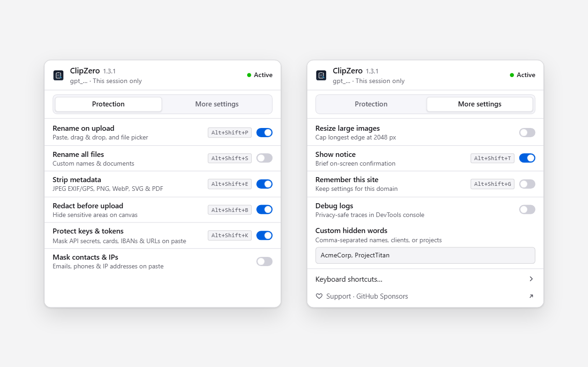

<div align="center">
  
  <h1>ClipZero</h1>
  <p>
    <strong>Local upload &amp; paste privacy firewall for Firefox and Chromium.</strong><br>
    Anonymizes filenames, strips metadata losslessly, redacts screenshots on Canvas, and masks secrets before websites read your data.
  </p>

  <p>
    <a href="https://addons.mozilla.org/firefox/addon/clipzero/"></a>
    <a href="https://github.com/m21dev/clipzero/actions/workflows/ci.yml"></a>
    
    
  </p>

  <p>
    <a href="#install">Install</a> &middot;
    <a href="#features">Features</a> &middot;
    <a href="#supported-formats">Formats</a> &middot;
    <a href="#keyboard-shortcuts">Shortcuts</a> &middot;
    <a href="CHANGELOG.md">Changelog</a> &middot;
    <a href="SECURITY.md">Security</a>
  </p>
</div>

---

Everything runs **100% locally inside your browser tab** before pages touch `paste`, `drop`, or `<input type="file">` events—with **zero API permissions**, **zero network calls**, **zero telemetry**, and **unminified source code**.

## Features

### Pre-Upload Canvas Redactor
Visually inspect and scrub screenshots inside an isolated Shadow DOM modal before upload: **Cover** solid blocks, irreversible **Pixelate (`P`)** mosaic (`<= 64×64` zeroed buffer), **Outline (`O`)** frames, **Pen (`D`)** strokes (`Thin` / `Medium` / `Thick`), non-destructive **Crop (`C`)** with live `origW×origH → outW×outH` output dimensions, **Scroll (`H`)**, batch slide navigation (`Skip` / `Include`, `PgUp` / `PgDn`), and single-touch `pointerId` palm rejection.

<p align="center">
  
</p>

### Secret, PII & Custom Words Guard
Detects and masks API keys, bearer tokens, JWTs, Luhn-valid payment cards, IBANs, URL credentials, private keys, optional emails/phones/IPs, and up to `50` user-defined **Custom hidden words** in both clipboard pastes and uploaded text/code files (`<= 512 KB`, tagged `Secrets masked` in the upload toast). Consistent session placeholders (`[REDACTED_*_N]`) stay reversible locally via the **Review** modal and **Restore originals** copy toast.

<p align="center">
  
</p>

### Zero-Permission Controls & Filename Anonymizer
Replaces identifying filenames (`Screenshot 2026-11-19.png` → `clip_a4f9c2.png`, or `doc_*` for documents in strict mode), automatically flattens decodable `.bmp`, `.ico`, `.tiff`, and `.heic`/`.heif` images to `.png`, caps optional output resolution at `2048 px`, flags un-reloaded open tabs (`!`), and cleanly tears itself down (`teardownMainWorld()`) if disabled or removed.

<p align="center">
  
</p>

---

## Supported Formats

All sanitization happens in volatile tab memory; your original files on disk are never modified.

| Format | Local Sanitization | Limits &amp; Notes |
| :--- | :--- | :--- |
| **JPEG** | Strips EXIF, GPS, XMP &amp; APP0 RGB thumbnails | Preserves safe orientation tag (`0x0112`) across progressive scans |
| **PNG / WebP** | Rebuilt via strict chunk allowlists | Removes `iDOT`, `C2PA`, `eXIf`, `tEXt`, `zTXt`, `iTXt` |
| **GIF / AVIF** | Strips GIF comments/XMP; cleans static AVIF files | `<= 256 KB` animated GIF probe; keeps animation frames intact |
| **SVG** | Removes `<script>`, `<foreignObject>`, `on*`, unsafe URIs &amp; CSS/`marker` URLs | Up to `8 MB` |
| **PDF** | Blanks `/Info` (direct, `#xx`, indirect) &amp; XMP packets in-place | Up to `50 MB`; `xref` tables &amp; bookmarks preserved |
| **Exotic Rasters** | Flattens `.bmp`, `.ico`, `.tiff`, `.heic`/`.heif` to `.png` | Handled via local Canvas when browser-decodable |
| **Text / Code Files** | Masks secrets, PII &amp; custom words in `.env`, `.txt`, `.json`, `.md`, `.log`, etc. | Up to `512 KB`; adds `Secrets masked` pill to upload toast |

---

## Install

### Firefox (`140+` Desktop &amp; `142+` Android)
- **Firefox Add-ons (recommended):** Install the signed extension from **[addons.mozilla.org/firefox/addon/clipzero](https://addons.mozilla.org/firefox/addon/clipzero/)**.
- **From source (development):** Open `about:debugging#/runtime/this-firefox` → **Load Temporary Add-on…** → select [`manifest.json`](manifest.json) (or run `python scripts/package.py` and load `dist/firefox/`).

### Chromium (`111+` Chrome, Edge, Brave — Developer Build)
- Download **`clipzero-chromium-1.3.3.zip`** from **[Releases](https://github.com/m21dev/clipzero/releases)** and extract it (or run `python scripts/package.py` to generate `dist/chromium/`).
- Open `chrome://extensions` (or `edge://extensions`), enable **Developer mode**, click **Load unpacked**, and select the extracted folder.
- Because Chromium enforces a maximum of `4` default `suggested_key` bindings per extension, the 4 primary shortcuts are pre-bound automatically and the other 3 can be configured at `chrome://extensions/shortcuts`.

---

## Keyboard Shortcuts

### Global Extension Shortcuts

| Windows / Linux | macOS | Action | Firefox | Chromium |
| :--- | :--- | :--- | :--- | :--- |
| `Alt+Shift+P` | `MacCtrl+Shift+P` | Pause / resume protection on active tab | Default | Default |
| `Alt+Shift+S` | `MacCtrl+Shift+S` | Toggle *Rename all files* (`strictMode`) | Default | Manual |
| `Alt+Shift+E` | `MacCtrl+Shift+E` | Toggle lossless metadata stripping | Default | Default |
| `Alt+Shift+B` | `MacCtrl+Shift+B` | Toggle pre-upload Canvas Redactor | Default | Default |
| `Alt+Shift+K` | `MacCtrl+Shift+K` | Toggle Secret &amp; API Key Guard | Default | Default |
| `Alt+Shift+T` | `MacCtrl+Shift+T` | Show / hide on-screen upload notice | Default | Manual |
| `Alt+Shift+G` | `MacCtrl+Shift+G` | Remember / forget settings for current domain | Default | Manual |

All 7 shortcuts are pre-bound by default in **Firefox** (`about:addons` → Manage Extension Shortcuts). **Chromium** limits extensions to 4 default bindings; the other 3 can be assigned manually at `chrome://extensions/shortcuts`.

### Canvas Redactor Shortcuts

`N` (add box) &middot; `P` (Pixelate) &middot; `O` (Outline) &middot; `D` (Pen) &middot; `C` (Crop) &middot; `H` (Scroll) &middot; `[` / `]` (cycle boxes) &middot; `Arrows` / `Shift+Arrows` (move / resize) &middot; `Del` (remove, undoable) &middot; `Ctrl`/`Cmd+Z` (Undo) &middot; `PageUp`/`PageDown` (batch slides) &middot; `Enter` (Upload).

---

## Supported Websites (55)

- **AI Chats &amp; Code Assistants:** Full Secret Guard + Metadata + Renamer enabled by default.
- **Messaging, Social Media &amp; Webmail:** Metadata + Renamer enabled by default; Secret Guard toggleable per domain.

<details>
<summary>View all 55 supported host patterns</summary>

- **AI Chats &amp; Builders:** Gemini (`gemini.google.com`), AI Studio (`aistudio.google.com`), ChatGPT (`chatgpt.com`), Claude (`claude.ai`), Perplexity (`perplexity.ai`, `www.perplexity.ai`), Grok (`grok.com`), Mistral (`chat.mistral.ai`, `lechat.mistral.ai`), Copilot (`copilot.microsoft.com`), Poe (`poe.com`), HuggingChat (`huggingface.co/chat/*`), DeepSeek (`chat.deepseek.com`), Qwen (`chat.qwen.ai`, `chat.qwenlm.ai`), Kimi (`kimi.com`, `www.kimi.com`, `kimi.ai`, `www.kimi.ai`, `kimi.moonshot.cn`), Z.ai (`chat.z.ai`), ChatGLM (`chatglm.cn`, `www.chatglm.cn`), Doubao (`doubao.com`, `www.doubao.com`), Yuanbao (`yuanbao.tencent.com`), Ernie (`yiyan.baidu.com`, `ernie.baidu.com`), NotebookLM (`notebooklm.google.com`), v0 (`v0.dev`), Bolt (`bolt.new`), Lovable (`lovable.dev`), OpenRouter (`openrouter.ai`), Duck.ai (`duck.ai`).
- **Developer:** GitHub (`github.com`).
- **Messaging &amp; Social:** WhatsApp Web (`web.whatsapp.com`), Telegram Web (`web.telegram.org`), Discord (`discord.com`), Messenger (`messenger.com`, `www.messenger.com`), Facebook (`facebook.com`, `www.facebook.com`, `m.facebook.com`), Instagram (`instagram.com`, `www.instagram.com`), X / Twitter (`x.com`, `twitter.com`), Reddit (`reddit.com`, `www.reddit.com`), LinkedIn (`www.linkedin.com`).
- **Webmail:** Gmail (`mail.google.com`), Outlook (`outlook.live.com`, `outlook.office.com`, `outlook.office365.com`, `outlook.cloud.microsoft`).

</details>

---

## Privacy, Architecture &amp; Checks

- **`content.js` (`MAIN` @ `document_start`):** Captures native DOM/Canvas/Event/MessagePort APIs at startup, enforces local scrubbing inside closed Shadow DOM, releases `ImageBitmap` and `<canvas>` buffers immediately, validates `injectedAtDocumentStart` on open tabs, and runs `teardownMainWorld()` if disabled or removed.
- **`bridge.js` (`ISOLATED` @ `document_start`):** Relays localized strings (`6` locales × `155` keys), commands, liveness pongs (`isExtensionContextAlive()`), and state queries across a token-authenticated `MessageChannel`.
- **`site_match.js`, `background.js` &amp; `popup.*`:** Flags already-open tabs missing injection (`!`), manages permission-reload arming, and forwards shortcuts with `0` API permissions (`data_collection_permissions: ["none"]`).

```bash
python tests/verify_repo.py   # Manifests (Firefox + Chromium), locales (155 keys x6), sinks & syntax
python scripts/package.py     # Builds dist/firefox/, dist/chromium/, and release ZIPs
```

<div align="center">
  <br>
  <a href="LICENSE">GPL-3.0-or-later</a> &middot;
  <a href="SECURITY.md">Security Policy</a> &middot;
  <a href="ROADMAP.md">Roadmap</a> &middot;
  <a href="https://github.com/sponsors/m21dev">Sponsor @m21dev</a>
</div>
