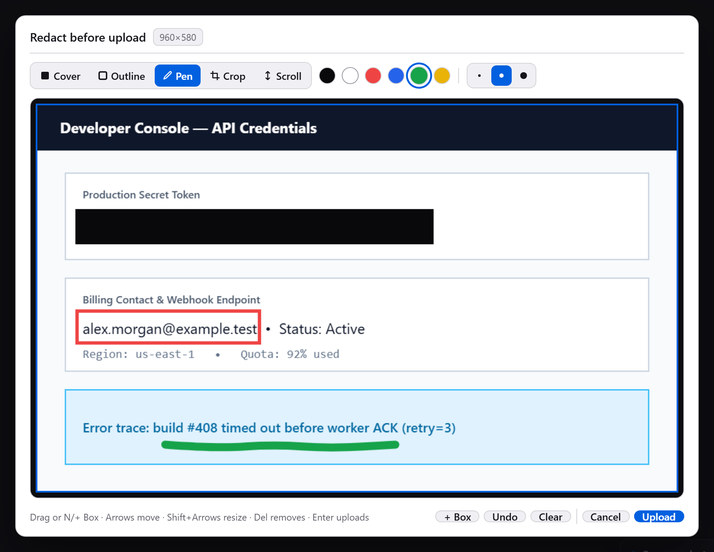
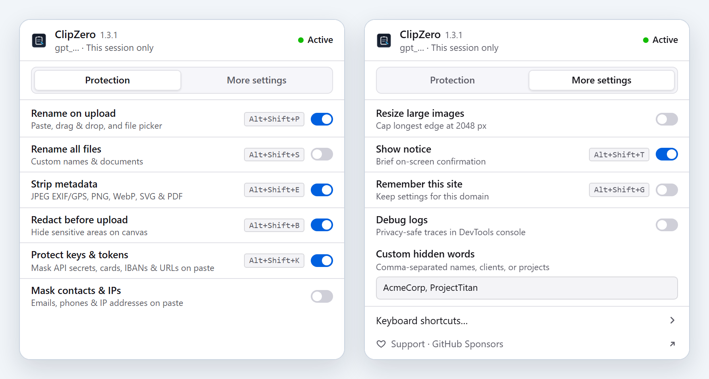

<div align="center">


# ClipZero

**100% local upload, metadata, canvas & secret firewall inside Firefox.**

[](https://addons.mozilla.org/firefox/addon/clipzero/)
[](https://github.com/m21dev/clipzero/actions/workflows/ci.yml)


[Install on Firefox Add-ons](https://addons.mozilla.org/firefox/addon/clipzero/) · [What's New in v1.3.1](#whats-new-in-v131) · [Roadmap](ROADMAP.md) · [Changelog](CHANGELOG.md) · [Security](SECURITY.md)

<br>



</div>

---

## Why ClipZero?

Every screenshot pasted into an AI chat, photo dragged into webmail, or log snippet pasted online can leak **camera GPS**, **OS filenames**, **PDF author tags**, or **live credentials**. ClipZero sanitizes everything **in memory inside your tab** before websites read the event—with zero external requests and zero API permissions.

| What You Share | Without ClipZero | With ClipZero |
| :--- | :--- | :--- |
| **Filenames** | `Screenshot 2026-11-17 1742.png` exposes OS, date & language | Anonymized to `clip_a4f9c2.png` (`doc_*` in strict mode) |
| **Photos & Docs** | GPS EXIF, thumbnails, PNG text chunks, SVG scripts, PDF authors | Stripped losslessly while keeping upright orientation & bookmarks |
| **Sensitive Screens** | Raw tokens, usernames, emails or faces visible | Permanent **Cover**, **Outline**, **Pen**, **Crop (`C`)** & **Scroll (`H`)** |
| **Pasted Text & Code** | API keys, JWTs, Luhn cards, IBANs, IPs or codenames exposed | Numbered `[REDACTED_*_N]` placeholders + **Restore originals** |

---

## What's New in `v1.3.1`

- **Single-Touch `pointerId` Lock:** Ignores accidental secondary fingers and palm contacts mid-stroke on Firefox Android (`142+`) and touchscreens, with `lostpointercapture` cleanup.
- **Stroke Weights (`Thin` / `Medium` / `Thick`):** Adjustable widths for **Outline** and **Pen**, scaled cleanly to export resolution.
- **Non-Destructive Crop (`C`):** Interactive margin trimming with live `W×H` readout, exact coordinate mapping alongside redactions, and arrow clamping inside active crops.
- **Scroll Mode (`H`) & Tall-Portrait Layout:** Native touch pan (`pan-x pan-y`) plus desktop mouse drag-to-pan and scrollable viewport sizing for long vertical phone screenshots.
- **Chronological Multi-Action Undo & Hardening:** `Delete`/`Backspace` on boxes is now undoable via `Undo` / `Ctrl+Z`, `+ Box` (`N`) switches out of `Crop`/`Scroll`, and `document_start` prototype isolation + SVG/PDF/bridge guards were tightened.

---

## Feature Matrix

### Visual Canvas Editor

| Tool / Control | Shortcut | Behavior |
| :--- | :---: | :--- |
| **Cover** | `N` / Drag | Irreversible solid fill in 6 high-contrast colors (no reversible blur/mosaic) |
| **Outline** | `O` | Crisp highlight frames leaving inner content readable (`Thin` / `Med` / `Thick`) |
| **Pen** | `P` | Smooth freehand quadratic strokes (`Thin` / `Med` / `Thick`) |
| **Crop** | `C` | Non-destructive region trim aligned pixel-for-pixel with all boxes |
| **Scroll** | `H` | Pan long vertical captures via touch or mouse drag without accidental strokes |
| **Precision Controls** | `Arrows` / `[` `]` | Move, `Shift+Arrow` resize, cycle boxes, `Del` (undoable), `PgUp`/`PgDn` slides |

### Lossless Metadata & Document Sanitizers

| Format | Local Sanitization | Limit / Notes |
| :--- | :--- | :--- |
| **JPEG** | Strips EXIF, GPS, XMP, and APP0 RGB thumbnails; rebuilds orientation (`0x0112`) | Handles progressive scans & trailers |
| **PNG & WebP** | Rebuilds from strict chunk allowlists (`iDOT`, `C2PA`, `tEXt`/`iTXt` purged) | Byte-exact lossless |
| **GIF & AVIF** | Strips GIF Comment/XMP extensions; re-exports static AVIFs carrying metadata | Preserves animated `NETSCAPE2.0` |
| **SVG** | Removes `<script>`, `<foreignObject>`, `on*`, unsafe URIs, CSS `@import`, `marker` URLs | Up to `8 MB` |
| **PDF** | Blanks `/Info` (direct, `#xx`, indirect refs) & XMP packets in-place | Up to `50 MB`; `xref` & bookmarks intact |
| **Exotic Rasters** | Flattens `.bmp`, `.ico`, `.tiff`, `.heic`/`.heif` cleanly to `.png` via Canvas | Only when browser decodes |

### Secret Guard, Session Tokens & Compact Popup

<div align="center">

</div>

- **Session Tokenization:** Consistent numbered placeholders (`[REDACTED_EMAIL_1]`, `[REDACTED_OPENAI_KEY_2]`) inside a bounded LRU vault (`<= 500` entries / `<= 1 MB`), selective **Review** checkboxes, **Custom hidden words**, and a **Restore originals** copy toast.
- **Zero-Permission Tab Detection:** `55` matched host patterns default to full Secret + Metadata protection on AI chats/GitHub and seamless Metadata + Renaming on social/webmail; already-open tabs show a `!` badge with a 1-click **Reload tab** button.

---

## Supported Sites (`55` Host Patterns)

| Category | Supported Domains |
| :--- | :--- |
| **AI Chats & Builders** | Gemini, AI Studio, ChatGPT, Claude, Perplexity, Grok, Mistral (`chat`/`lechat`), Copilot, Poe, HuggingChat (`/chat/*`), DeepSeek, Qwen, Kimi, Z.ai, ChatGLM, Doubao, Yuanbao, Ernie/Yiyan, NotebookLM, v0, Bolt, Lovable, OpenRouter, Duck.ai |
| **Developer** | GitHub |
| **Messaging & Social** | WhatsApp Web, Telegram Web, Discord, Messenger, Facebook (`www`/`m`), Instagram, X / Twitter, Reddit, LinkedIn |
| **Webmail** | Gmail, Outlook (`live.com`, `office.com`, `office365.com`, `cloud.microsoft`) |

---

## Keyboard Shortcuts

| Windows / Linux | macOS | Action |
| :--- | :--- | :--- |
| `Alt+Shift+P` | `MacCtrl+Shift+P` | Pause / resume protection on active tab |
| `Alt+Shift+S` | `MacCtrl+Shift+S` | Rename all files & documents (`strictMode`) |
| `Alt+Shift+E` | `MacCtrl+Shift+E` | Toggle lossless metadata cleaning |
| `Alt+Shift+B` | `MacCtrl+Shift+B` | Toggle pre-upload Canvas visual editor |
| `Alt+Shift+K` | `MacCtrl+Shift+K` | Toggle Secret & API Key Guard on paste |
| `Alt+Shift+T` | `MacCtrl+Shift+T` | Show / hide on-screen confirmation notice |
| `Alt+Shift+G` | `MacCtrl+Shift+G` | Remember / forget settings for current site |

---

## Installation

- **Official Firefox Release (Recommended):** Install the Mozilla-signed add-on from **[addons.mozilla.org/firefox/addon/clipzero](https://addons.mozilla.org/firefox/addon/clipzero/)**.
- **Load Unpacked Source (Dev):** Open `about:debugging#/runtime/this-firefox` → **Load Temporary Add-on…** → select [`manifest.json`](manifest.json).

---

<details>
<summary><strong>Architecture, Memory Bounds & Local Verification</strong></summary>

1. **`content.js` (`MAIN` world @ `document_start`):** Captures native DOM/Canvas/Event/MessagePort globals at startup, enforces fail-closed sanitization, isolates UI in closed Shadow DOM (`:host{all:initial...}`), streams `ImageBitmap` previews (`<= 2` live cached slides at `1400 px`), exports sequentially, and zeroes `<canvas>` buffers immediately.
2. **`bridge.js` (`ISOLATED` world @ `document_start`):** Runs after `content.js`; relays i18n (`6` locales × `152` keys), commands, and popup state over a validated `MessageChannel` with cold-start retry recovery.
3. **`site_match.js` & `background.js`:** Event-driven tab reload flagging (`!`), permission-prompt reload arming/disarming, and strict `sender.id` command relay with `0` API permissions.
4. **Checks & Packaging (Python `3.9+`):**
   ```bash
   python tests/verify_repo.py   # Manifest, locales (152 keys x6), static sinks & JS syntax
   python scripts/package.py     # Builds clean runtime ZIP inside dist/
   ```
   No bundlers or minifiers are used—source files shipped to AMO match this repository verbatim.

</details>

---

## License & Support

- **License:** [GNU General Public License v3.0 or later (`GPL-3.0-or-later`)](LICENSE)
- **Security:** See [SECURITY.md](SECURITY.md) for responsible disclosure rules
- **Support (Optional):** [Sponsor `@m21dev` on GitHub](https://github.com/sponsors/m21dev)
