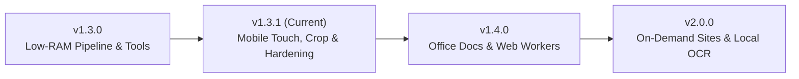

# ClipZero Roadmap

> **Core principles:** 100% local execution inside Firefox, zero network calls, zero telemetry, minimal permissions (`0` API permissions), and readable unminified source.

---

## Shipped

### `v1.3.1` — Mobile & Editor Polish *(Current)*
- **Active `pointerId` touch lock:** Ignores accidental secondary fingers and palm touches during drawing/cropping, with `lostpointercapture` cleanup.
- **Stroke widths:** Thin, Medium, and Thick selector for **Outline** and **Pen** tools.
- **Non-destructive Crop (`C`):** Interactive margin cropping aligned pixel-for-pixel with redaction marks, plus arrow clamping inside active crops.
- **Scroll mode (`H`) & tall-portrait layout:** Touch `pan-x pan-y` plus desktop mouse drag-to-pan for long phone screenshots.
- **Undo & security hardening:** Chronological undo history including deleted boxes, expanded `document_start` native captures, SVG `marker` URL and PDF XMP fixes, fail-closed paste/bridge checks, and clean permission-reload disarming.

### `v1.3.0` — Low-RAM Pipeline & Batch Redactor
- **Cover / Outline / Pen** tools across 6 colors with per-tool color memory, batch pagination + jump selector, and rich-text focus restoration.
- EXIF-aware `ImageBitmap` decoding (`1400 px` preview cache, `<= 2` live batch slides), immediate `<canvas>` memory release, and `<= 500`-entry / `<= 1 MB` LRU token storage.
- `site_match.js` `!` reload badge on already-open tabs, compact `408 px` tabbed popup, and `MessageChannel` ACK cold-start recovery.

---

## Ongoing Maintenance
- **DOM adapter resilience:** Keep paste, drop, and hidden file-input hooks reliable as supported web apps (WhatsApp Web, Outlook, Gmail, Gemini) update their frontend editors.

---

## Planned

### `v1.4.0` — Office Documents, Web Workers & Portable Rules
- **Local Office metadata scrubber (`.docx`, `.xlsx`, `.pptx`):** Strip `docProps/core.xml`, `app.xml`, authors, and revision metadata in memory while preserving ZIP structure.
- **Web Worker offloading:** Move heavy PDF (`<= 50 MB`), Office XML/ZIP, and large SVG parsing to workers with `Transferable` buffers.
- **Portable rules & token inspector:** Local JSON config export/import, custom regex rules, and a popup token inspector for the active session.

### `v2.0.0` — On-Demand Sites, Offline OCR & Multi-Browser
- **On-demand custom sites (`optional_host_permissions`):** Activate ClipZero on Notion, Slack, Teams, Jira, or private portals on request without expanding default install permissions.
- **Offline image OCR (local WASM):** Detect emails, tokens, cards, or custom words inside screenshots locally and suggest Cover boxes before upload.
- **Chromium MV3 parity:** Shared unminified codebase alongside Firefox Desktop and Android packages.
