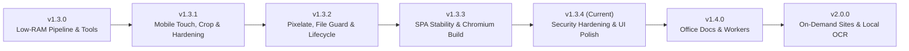

# ClipZero Roadmap

> **Core principles:** 100% local execution inside Firefox, zero network calls, zero telemetry, minimal permissions (`0` API permissions), and readable unminified source.

---

## Shipped

### `v1.3.4` — Security Hardening & Soft-Geometry UI Polish *(Current)*
- **Extension-isolated `IndexedDB` storage & audit hardening:** Moved per-site preferences and `customWords` from host `window.localStorage` into extension-origin `IndexedDB` (`clipzero_prefs_db`) scoped to verified `sender.url` origins, added fail-closed text/mixed-paste scanning, complete `document_start` native captures, strict `bridge.js`/`background.js` validation, dead-port cleanup, and synchronous teardown guards.
- **Sober soft-geometry Firefox Acorn UI & icon refresh:** Upgraded the toolbar icon (`16`–`128 px`), redesigned Light/Dark floating toast, unified dark-mode Firefox Blue (`#0a84ff`) buttons, and refined spacing, rounding, status pills, inset toggle rows, and modals across all 4 surfaces.

### `v1.3.3` — SPA Stability & Chromium MV3 Build
- **SPA chat-switch stability:** Freeze-proof 2-hop `checkBridgeAlive` timing without `pointerdown`/`keydown` triggers, explicit `{ alive: false }` bridge pong on uninstall/disable, and `hasIsolatedBridge` bound strictly on `MessagePort`.
- **Dual Firefox + Chromium MV3 builds:** Shared codebase now outputs `dist/firefox/` and `dist/chromium/` (`service_worker`, `minimum_chrome_version: "111"`, 4 default shortcuts) via `scripts/package.py`.

### `v1.3.2` — Pixelate, Custom Words UX & Lifecycle Hardening
- **Irreversible Pixelate (`P`) & live dimensions pill:** Quantized mosaic tool (`#09090b` base + zeroed `<= 64×64` buffer), `D` shortcut for Pen, real-time `origW×origH → outW×outH` output dimensions badge, `28 px` modal footer buttons, and overflow-free stage.
- **Custom hidden words & upload toast tags:** Added `0/50` counter, **Clear** button, auto-remember current site on save, and `Secrets masked` upload toast tag for text/code uploads.
- **Lifecycle safety & R2 RAM optimization:** Automatic `MAIN`-world teardown when the extension is removed/disabled (`teardownMainWorld`), `injectedAtDocumentStart` verification for already-open tabs, shared `XMLSerializer`, `256 KB` animated GIF probing, `<noscript>` HTML wrapper fix, and `scheduleUnconfirmedCleanup(700)`.

### `v1.3.1` — Mobile & Editor Polish
- **Active `pointerId` touch lock:** Ignores accidental secondary fingers and palm touches during drawing/cropping, with `lostpointercapture` cleanup.
- **Stroke widths:** Thin, Medium, and Thick selector for **Outline** and **Pen** tools.
- **Non-destructive Crop (`C`):** Interactive margin cropping aligned pixel-for-pixel with redaction marks, plus arrow clamping inside active crops.
- **Scroll mode (`H`) & tall-portrait layout:** Touch `pan-x pan-y` plus desktop mouse drag-to-pan for long phone screenshots.
- **Undo & security hardening:** Chronological undo history including deleted boxes, expanded `document_start` native captures, SVG `marker` URL and PDF XMP fixes, fail-closed paste/bridge checks, and clean permission-reload disarming.

### `v1.3.0` — Low-RAM Pipeline & Batch Redactor
- **Cover / Outline / Pen** tools across 6 colors with per-tool color memory, batch pagination + jump selector, and rich-text focus restoration.
- EXIF-aware `ImageBitmap` decoding (`1400 px` preview cache, `<= 2` live batch slides), immediate `<canvas>` memory release, and `<= 500`-entry / `<= 1 MB` LRU token storage.
- `site_match.js` `!` reload badge on already-open tabs, compact `408 px` tabbed popup, and `MessageChannel` ACK cold-start recovery.

---

## Ongoing Maintenance
- **DOM adapter resilience:** Keep paste, drop, and hidden file-input hooks reliable as supported web apps (WhatsApp Web, Outlook, Gmail, Gemini) update their frontend editors.

---

## Planned

### `v1.4.0` — Office Documents, Workers & Rule Portability
- **Local Office metadata scrubber (`.docx`, `.xlsx`, `.pptx`):** Strip `docProps/core.xml`, `app.xml`, authors, and revision metadata in memory while preserving ZIP structure.
- **Web Worker offloading:** Move heavy PDF (`<= 50 MB`), Office XML/ZIP, and large SVG parsing to workers with `Transferable` buffers.
- **Portable rules & token inspector:** Local JSON config export/import, custom regex rules, and a popup token inspector for the active session.

### `v2.0.0` — On-Demand Sites, Offline OCR & Multi-Browser
- **On-demand custom sites (`optional_host_permissions`):** Activate ClipZero on Notion, Slack, Teams, Jira, or private portals on request without expanding default install permissions.
- **Offline image OCR (local WASM):** Detect emails, tokens, cards, or custom words inside screenshots locally and suggest Cover boxes before upload.
- **Chromium MV3 parity:** Shared unminified codebase alongside Firefox Desktop and Android packages.
