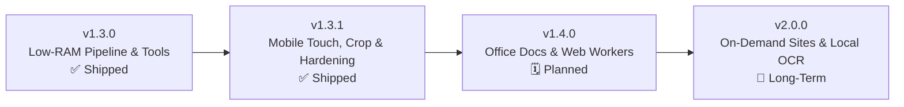

# ClipZero Roadmap

> **Core Invariants (Non-Negotiable):** 100% local execution · Zero telemetry · Zero remote network calls · Minimal permissions (`0` API permissions today) · Unminified readable source.

| Milestone | Theme | Status |
| :--- | :--- | :--- |
| **`v1.3.1` *(Current)*** | Mobile `pointerId` lock, stroke weights, non-destructive Crop (`C`), Scroll (`H`) & hardening | ✅ **Shipped** |
| **`v1.3.0`** | Cover/Outline/Pen editor, `ImageBitmap` streaming, bounded LRU vault, tabbed popup | ✅ **Shipped** |
| **Maintenance** | Site DOM adapter resilience (WhatsApp Web, Outlook, Gmail, Gemini) | 🔄 **Ongoing** |
| **`v1.4.0`** | Local `.docx`/`.xlsx`/`.pptx` scrubber, Web Worker parsing, portable JSON rules & regexes | 🗓️ **Mid-Term** |
| **`v2.0.0`** | Optional custom-site activation, offline WASM OCR box suggestions, Chromium MV3 build | 🔭 **Long-Term** |

---

## ✅ Shipped — `v1.3.1` ("Mobile & Editor Polish")

- **Single-Touch `pointerId` Lock:** Tracks the active primary pointer across draw/cancel/`lostpointercapture` so palm contacts and second fingers never leak strokes on Firefox Android (`142+`).
- **Stroke Widths (`Thin` / `Medium` / `Thick`):** Selectable sizes for **Outline** and **Pen** tools scaled accurately to full export resolution.
- **Non-Destructive Crop (`C`):** Interactive margin cropping with live `W×H`, aligned box coordinate mapping, keyboard box clamping inside crops, and chronological `Undo` including undoable `Delete`.
- **Scroll Mode (`H`) & Tall-Portrait Canvas:** Dedicated pan tool (`touch-action: pan-x pan-y` + desktop mouse drag) alongside scrollable portrait sizing for long phone screenshots.
- **Security & Ergonomics Hardening:** Expanded `document_start` native captures, fail-closed paste/sender guards, hardened `MessagePort` handling, SVG `marker` & PDF XMP fixes, `clipzero:disarm-reload`, and `152` cleaned locale keys × 6 languages.

<strong>Previous Release Summary — v1.3.0</strong>

- **Canvas Tools & Batch UI:** Cover, Outline, and Pen modes across 6 colors with independent per-tool color memory, windowed batch pagination, quick slide `<select>`, and rich-text focus restoration.
- **Low-RAM Pipeline:** Native `ImageBitmap` (`imageOrientation: 'from-image'`), cached `1400 px` preview windows (`<= 2` live slides), 1-by-1 full-res export, immediate canvas zeroing, and bounded `500`-entry / `1 MB` LRU token storage.
- **Popup & Tab Detection:** `site_match.js` `!` reload badge on already-open tabs, 1-click **Reload tab**, `408 px` tabbed popup without scrollbars, and cold-start `MessageChannel` ACK recovery.

---

## 🔄 Incremental Maintenance

- **Live Site DOM Adapters:** Keep paste, drop, and hidden `<input type="file">` hooks reliable as WhatsApp Web, Outlook Web, Gmail, and Gemini update their frontend editors.

---

## 🗓️ Mid-Term — `v1.4.0` ("Office Docs, Web Workers & Portable Rules")

- **Local Office Scrubber (`.docx`, `.xlsx`, `.pptx`):** Strip `docProps/core.xml`, `app.xml`, authors, company names, and local revision paths in memory without corrupting ZIP integrity.
- **Web Worker Offloading:** Move heavy PDF (`<= 50 MB`), Office XML/ZIP, and large SVG parsing into workers with `Transferable` buffers for zero main-thread UI hitching.
- **Portable Config & Power Rules:**
  - Local **Export / Import JSON** backups (reusing toggles and *Custom hidden words* without adding `"storage"` permissions).
  - User-defined **Custom Regex Patterns** (national IDs, internal ticket IDs, project codes).
  - **Session Token Inspector** in the popup to check or copy `[REDACTED_*_N]` mappings without scrolling long chats.

---

## 🔭 Long-Term — `v2.0.0` ("On-Demand Sites, Offline OCR & Multi-Browser")

- **On-Demand Custom Sites (`optional_host_permissions`):** Let users activate ClipZero on Notion, Slack, Teams, Jira, or private portals in 1 click without expanding default install permissions.
- **100% Offline Image OCR (Local WebAssembly):** Scan screenshots locally for emails, keys, cards, or custom words and pre-place suggested **Cover** boxes inside the modal before upload.
- **Dual MV3 Packaging (Firefox + Chromium):** Keep one unminified codebase across Firefox Desktop/Android, Chrome Web Store, Edge, and Brave.
